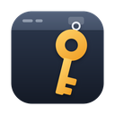

# KeyBar

*for OnlyKey devices*

 

> **This is an unofficial fork of the [OnlyKey App](https://github.com/trustcrypto/OnlyKey-App).**
> It is not made, endorsed or supported by CryptoTrust, the makers of OnlyKey.
> For the official app, installers and support, go to
> [trustcrypto/OnlyKey-App](https://github.com/trustcrypto/OnlyKey-App).

**KeyBar** is based on OnlyKey App 5.5.0 and changes how the app works on macOS:

- **Menu-bar app:** no Dock icon and no window that is always open. Everything is reached
  from the KeyBar icon (a key) in the menu bar: the key's status, unlocking, and shortcuts to
  Slots, Keys, Backup/Restore, Firmware, Preferences, Advanced, Tools and Setup. The full
  window opens only when you ask for it, and closing it keeps the app running.
- **Small unlock window:** plugging in a locked OnlyKey opens a compact window just for
  the PIN, which closes by itself once the key is unlocked.
- **Native Apple Silicon (arm64) build**, based on NW.js 0.117 (the official app is an
  Intel build that needs Rosetta).
- **Installs next to the official app**, with its own name, icon, bundle ID and settings.
  (Versions 0.1.x were called *OnlyKey Menu Bar*; the name was changed because the OnlyKey
  license doesn't allow "OnlyKey" in the name of derived products.)
- **About window** with the version, a notice that KeyBar is not endorsed by CryptoTrust,
  and the license.
- **No known vulnerable dependencies** (`npm audit`: 0): the abandoned `request` package,
  gulp, `appdmg` and the app self-update check were replaced or removed.

Windows and Linux behave as in the official app, but have not been tested with this fork.
See [MACOS.md](MACOS.md) for the details, building, and troubleshooting.

OnlyKey itself can be purchased here: [OnlyKey order](http://www.crp.to/p/). Just getting
started with OnlyKey? [Start here](http://www.crp.to/okstart).

## About

Like the official **OnlyKey App**, this is an app to be used along with an OnlyKey device. The app is used for things like:

- Initial setup of OnlyKey (Setup)
- Configuration of accounts (Slots)
- Loading keys for PGP, SSH, and secure backup (Keys)
- Backup and restore of OnlyKey (Backup/Restore)
- Setting OnlyKey preferences (Preferences)
- Setting advanced options such as Yubikey and U2F security info (Advanced)

*The app is required on all systems where OATH-TOTP (Google Authenticator) is used*

For information on using the app see the [OnlyKey User's Guide](https://docs.crp.to/usersguide.html) or [OnlyKey DUO User's Guide](https://docs.crp.to/usersguide.html) 

## Installation

There are no ready-made downloads of this fork: you build it yourself on your Mac, which
takes a few minutes. See **[MACOS.md](MACOS.md)** for the requirements and steps. In short:

    $ npm install
    $ npm run release

This creates `releases/KeyBar_<version>_arm64.dmg`. Open it and drag *KeyBar* to
Applications. If you copy the DMG to another Mac, macOS will block
the app the first time; allow it under System Settings → Privacy & Security → *Open Anyway*.

Run either this app or the official one at a time, not both: they both talk to the key.

For the official app (installers for macOS, Windows and Linux, and the Chrome app), see
the [official repository](https://github.com/trustcrypto/OnlyKey-App) and its
[releases](https://github.com/trustcrypto/OnlyKey-Chrome-App/releases/latest).

## Support ##

For problems with **this fork** (menu bar, unlock window, the macOS build), please open an
issue in [this repository](https://github.com/ronbuist/OnlyKey-App/issues), not with CryptoTrust.

For questions about OnlyKey itself:

- [OnlyKey Support Forum](https://onlykey.discourse.group/)
- [OnlyKey Documentation](https://docs.crp.to)

## Developer Notes

This repository contains shared code that can be used to build multiple types of
apps. The build uses plain Node.js scripts in `tasks/` (no gulp). It needs Node.js 22.12 or
later; Node.js 22 LTS is the tested and recommended version (see [MACOS.md](MACOS.md)).

To run as NWJS app in development mode (rebuilds when files in `app/` change):

    $ npm start

To build into `build/` only:

    $ npm run build

To create releases:

    $ npm run release

(npm runs the `prerelease` script first by itself: a clean install of the app's own
dependencies and a production build.)

This will create an installer in the `releases/` subfolder. The installer is created for the
current OS (and, on macOS, for the Mac's architecture); see [MACOS.md](MACOS.md) for macOS.
On Windows, you need to install [NSIS](https://nsis.sourceforge.io/) first, and ensure that
it's present in your shell's `%PATH%`. That is, add `C:/Program Files (x86)/NSIS` or similar
to your `%PATH%` in the operating system settings.

To run this code as a Chrome app:

    $ npm run chrome

To run tests:

    $ npm test

Running tests requires the SDK version of NW.js, which comes with a `chromedriver` that
handles automated Selenium tests. To install that version, run
`rm -rf node_modules && NWJS_BUILD_TYPE=sdk npm install`. Note that to create releases, you
should install the normal version again; otherwise the installer will be unnecessarily large.

## Cryptography Notice

This distribution includes cryptographic software. The country in which you currently reside may have restrictions on the import, possession, use, and/or re-export to another country, of encryption software.
BEFORE using any encryption software, please check your country's laws, regulations and policies concerning the import, possession, or use, and re-export of encryption software, to see if this is permitted.
See <http://www.wassenaar.org/> for more information.

The U.S. Government Department of Commerce, Bureau of Industry and Security (BIS), has classified this software as Export Commodity Control Number (ECCN) 5D002.C.1, which includes information security software using or performing cryptographic functions with asymmetric algorithms.
The form and manner of this distribution makes it eligible for export under the License Exception ENC Technology Software Unrestricted (TSU) exception (see the BIS Export Administration Regulations, Section 740.13) for both object code and source code.

The following cryptographic software is included in this distribution:

   "OpenPGP.js - OpenPGP JavaScript Implementation." - https://openpgpjs.org/

For more information on export restrictions see: http://www.apache.org/licenses/exports/

## Source and license

- This fork: [ronbuist/OnlyKey-App](https://github.com/ronbuist/OnlyKey-App)
- Official OnlyKey App: [trustcrypto/OnlyKey-App](https://github.com/trustcrypto/OnlyKey-App)

This product includes software developed by the OnlyKey Project (http://www.crp.to/ok).

**License.** KeyBar is distributed under the license in [LICENSE.txt](LICENSE.txt): a short
KeyBar section, followed by the original OnlyKey license (Copyright (c) 2017, CryptoTrust LLC),
unchanged. The official app's `package.json` listed "Apache-2.0", but the license file is
what applies; `package.json` here now says `SEE LICENSE IN LICENSE.txt`.

**Who made the changes.** Modifications Copyright (c) 2026 Ron Buist. The modifications in this
fork were written by Claude, an AI model made by Anthropic, at the request and under the
direction of Ron Buist. They are distributed under the same terms as the original license.

**Third-party software** included in the app (NW.js, OpenPGP.js, FileSaver.js and a few npm
packages) is listed with its licenses in `THIRD-PARTY-NOTICES.txt`. That file is generated
during the build (`tasks/thirdPartyNotices.js`) and shown in the app under *About KeyBar →
Third-Party Notices*; the license texts of the bundled libraries are in `resources/licenses/`.

The changes in this fork are listed above, in [MACOS.md](MACOS.md) and in the git history.
OnlyKey is a trademark of its owner; this fork is not affiliated with or endorsed by
CryptoTrust or the OnlyKey Project.
